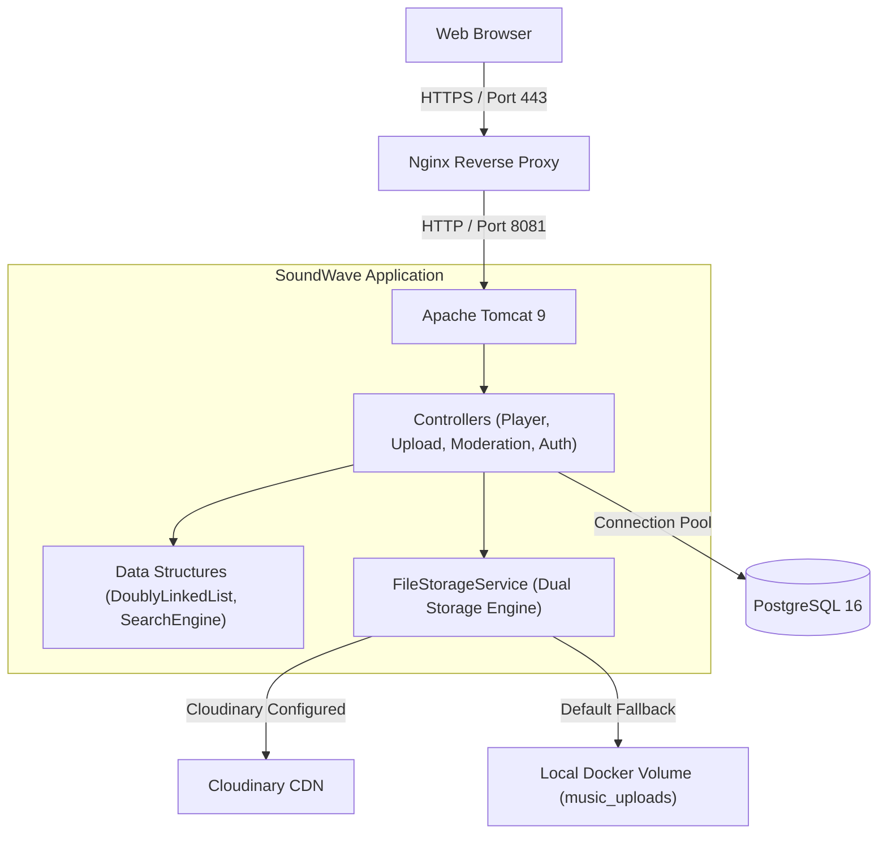

# SoundWave — Cloud-Native Music Streaming & Playlist Manager

[](https://www.oracle.com/java/)
[](https://tomcat.apache.org/)
[](https://www.postgresql.org/)
[](https://www.docker.com/)
[](https://cloudinary.com/)
[](LICENSE)

Live Demo: https://soundwave.hufudev.me

SoundWave is a full-stack Java web application designed for music streaming, playlist management, and community music sharing with role-based content moderation.

---

## Core Features

### Audio Streaming and Player Controls
* Persistent Player: Continuous audio playback across page transitions with queue management, timeline seeking, volume control, repeat modes (None, One, All), and shuffle.
* Playback Navigation: Next and previous track handling with listening history tracking.

### Playlist and Favorites Management
* Custom Playlists: Create, rename, delete, and organize tracks into playlists.
* Favorites Collection: One-click favorite toggle synced across all views.

### Data Structures and Search Engine
* Doubly Linked List Queue: In-memory queue data structure powering track navigation, queue reordering, and playback history.
* Multi-Field Search: Lookup engine filtering tracks across Song Title, Artist, and Genre.
* Multi-Genre Discovery: 9 genre categories (Pop, Ballad, R&B, Hip Hop, Rock, Electronic / EDM, Acoustic, Lo-Fi / Chill, Barbie).

### Dual Storage Architecture
* Cloudinary CDN Integration: Direct upload and delivery for audio files and album artwork via Cloudinary CDN.
* Local Storage Fallback: Storage mode saving files to persistent Docker volumes.
* File Validation: Validates size limits (15MB Audio, 5MB Image) and verifies file header Magic Bytes to prevent invalid uploads.

### Role-Based Access Control and Moderation
* Upload Visibility Modes:
  * Private: Saved to personal collection, accessible only to the uploader.
  * Public: Submitted to community catalog, requiring Admin approval.
* Admin Moderation Dashboard: Review interface for Administrators to listen to preview tracks, approve, or reject submissions with feedback.
* Environment Security: Admin accounts are initialized and synced via environment variables with SHA-256 password hashing.

---

## Architecture and Tech Stack



* Backend: Java Servlet, JSP, JSTL, Apache Tomcat 9, OpenJDK 8.
* Database: PostgreSQL 16.
* Storage and CDN: Cloudinary SDK (com.cloudinary:cloudinary-http44:1.36.0).
* Infrastructure: Docker multi-stage build, Docker Compose, Nginx, Let's Encrypt SSL.

---

## Project Structure

```text
MusicStreamingPlaylistManager/
├── src/
│   └── main/
│       ├── java/
│       │   ├── controllers/         # Servlets (Player, Upload, Moderation, MediaServe, Auth)
│       │   ├── lib/                 # Core DSA (SongSearchEngine, IndexedDoublyLinkedList)
│       │   ├── listeners/           # ServletContextListener (Auto-seed Admin and library preload)
│       │   ├── models/              # Models and DAO layer (User, Song, Playlist)
│       │   └── utils/               # Utilities (FileStorageService, DBUtils, PasswordUtils)
│       └── webapp/
│           ├── assets/              # Styles, client-side player scripts, and catalog audio
│           ├── includes/            # Reusable layout fragments
│           ├── home.jsp             # Discovery and featured tracks
│           ├── search.jsp           # Genre browse and search
│           ├── upload.jsp           # Song upload portal
│           ├── my-uploads.jsp       # Personal collection and upload management
│           └── moderation.jsp       # Admin moderation dashboard
├── docker-compose.yml               # Multi-container orchestration (App and Database)
├── Dockerfile                       # Multi-stage Docker build
├── init.sql                         # Database schema and initial catalog
├── .env.example                     # Environment configuration template
└── pom.xml                          # Maven dependencies
```

---

## Authors and Team
* Huynh Huu Phuc (Lead Developer / DevOps) — https://github.com/Phuc3326
* Ho Le Thien An
* Nguyen Hoang Khoi
* Pham Tuan Trien
* Institution: FPT HCM University
